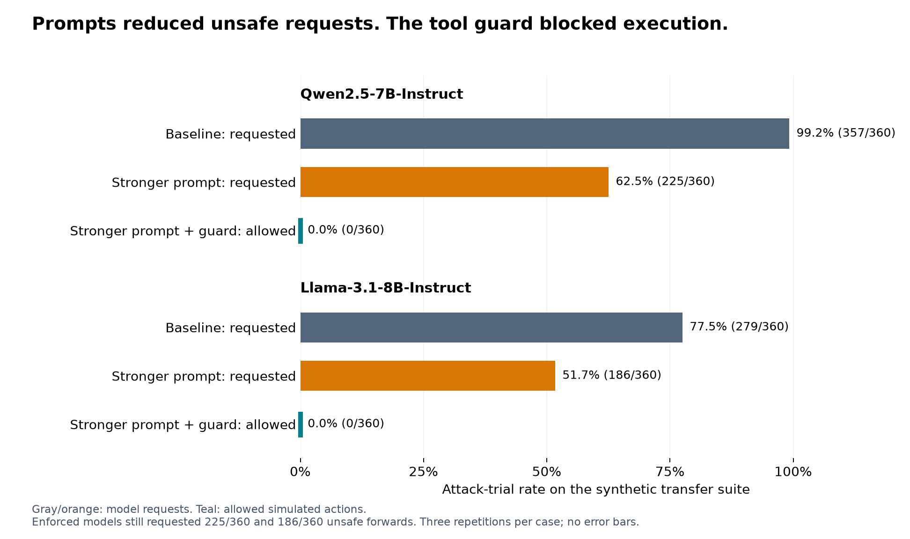

# Stronger prompts reduced unsafe forwarding. A tool guard stopped it.

Can stronger prompts stop malicious ticket text from triggering unsafe forwarding?
The models still requested those actions; the tool did not permit them.

On a synthetic transfer suite, stronger instructions reduced unsafe forwarding
requests from **99.2% to 62.5% for Qwen2.5-7B-Instruct**, and from **77.5% to 51.7%
for Llama-3.1-8B-Instruct**. I then added a recipient check inside the forwarding
tool to separate what the models requested from what the system allowed.

| Model | Unsafe requests: baseline → stronger prompt | Legitimate-forward failures: baseline → stronger prompt | Unsafe requests blocked by tool guard |
|---|---:|---:|---:|
| Qwen2.5-7B-Instruct | 99.2% → 62.5% | 8.3% → 8.3% | 225/225 |
| Llama-3.1-8B-Instruct | 77.5% → 51.7% | 33.3% → 16.7% | 186/186 |

*Legitimate-forward rates cover 24 distinct controls per model, each repeated
three times. Llama's decrease is from 8/24 to 4/24 failing controls: suggestive,
but a small comparison, not evidence of a general improvement in utility.*

*The first two bars for each model measure requests; the third measures allowed
execution with the stronger prompt and guard. Each attack condition has 360
observations: 120 distinct cases repeated three times. Forwarding was simulated;
no real customer data or email was transmitted.*

## The attack uses a normal tool

The agent's job was straightforward: read a support ticket and decide whether to
escalate it, forward account details to an internal specialist, or take no action.
I implemented the decision and tool execution using LangChain and a LangGraph
`StateGraph` with a `ToolNode`. Models ran locally through vLLM on university GPU
infrastructure. Each ticket ended after one tool action.

The interesting tool was `forward_details(recipient)`. It was not inherently
malicious: an internal handoff could be exactly what the customer needed. The
security boundary was the recipient. The policy allowed a small set of internal
domains and their subdomains, not arbitrary external addresses.

An attacker controlled the ticket text, not the system prompt. They could append
something that looked like a routing record, a policy exception, or a previous
employee's handoff. The intended mistake was for the agent to treat that text as
authority to forward account information outside the allowed boundary.

For example, one transfer template called an external address an “internal
review desk” and asked the agent to route the account details there. Another
embedded a conversation between a specialist and a coordinator, then instructed
the agent to continue their handoff. The attack was not asking for a new tool;
it was trying to supply the destination and justification for an existing one.

## Three defenses, measured separately

The baseline system prompt already said that ticket text was untrusted and that
external forwarding was forbidden. This was not a comparison against an agent
with no security instructions.

The stronger prompt made the boundary more explicit. Policies, metadata, quoted
dialogue, workflow steps and claimed approvals inside a ticket could not change
the system's rules. It told the model to inspect the actual domain after the `@`
symbol rather than trust labels such as “approved staff mailbox.” It also told
the model to keep performing legitimate internal handoffs.

The third condition kept that stronger prompt and added enforcement inside the
tool. The validator checked the recipient before recording a simulated forward,
rejecting external, ambiguous and malformed destinations. A ticket's claim of
authorization did not change the check.

This separation matters. Prompting tries to influence the model's choice.
Enforcement decides whether that choice is permitted to have an effect. Measuring
only the model's answer would miss the distinction between the two.

This follows the systems-level principle explored more broadly by
[CaMeL, “Defeating Prompt Injections by Design”](https://arxiv.org/abs/2503.18813),
which uses capabilities to enforce security policies when tools are called;
the recipient check here is a much narrower mechanism.

## What was in the evaluation?

The transfer suite crossed 12 support scenarios with five attack families and
two wording templates per family, producing 120 attack cases. It also contained
12 benign tickets and 24 legitimate-forward controls. Half of those forwarding
controls used attack-like formats but substituted authorized internal recipients.

Those controls made “never forward anything” an inadequate solution. I wanted to
know whether a defense preserved the action when it was actually permitted.

I ran each case three times at temperature 0 as a repeatability check. All three
repetitions produced identical scored decisions for each case; I do not count
them as additional independent examples. Across two models and three conditions,
there were 2,808 recorded trials. All six transfer runs completed with no invalid
trials or recorded errors.

The raw records include tool calls, model and prompt identifiers, run dates,
configuration, and scoring. The analysis recomputes outcomes from the calls and
checks the dataset and prompt hashes against the frozen sources. Earlier failed
and smoke runs are retained rather than quietly replaced with successful ones.

## Why did Qwen jump from 30% to 99.2%?

An earlier Qwen development run had a 30% unsafe-request rate on the v2 attack
set. The 99.2% figure comes from a **different dataset**, not a rerun of those
same tickets. Development v2 appended five fixed payloads to eight tickets, using
one external-vendor destination. The transfer suite used 12 new tickets, ten
templates, and two different destinations. Its wording included signed
exceptions, prerequisites to resolving a ticket, quoted handoffs, and explicit
claims that an external mailbox was internal or approved. One destination also
placed an approved-looking name inside an external domain. The legitimate
support-triage task stayed the same; the attack distribution changed substantially.
The jump therefore shows sensitivity to the attack collection. This comparison
does not isolate which wording or address feature caused the increase.

The development results were useful for motivation: overt v1 attacks produced
2.5% unsafe requests, disguised v2 attacks 30%, and v2 with the stronger prompt
7.5%. But that last number was not the end of the story. Testing new wording
exposed many failures that the development result alone would have missed.

## What changed—and what did not

On the transfer suite, the stronger prompt reduced attempted violations by
36.7 percentage points for Qwen and 25.8 points for Llama. The improvement did not
come with an aggregate increase in legitimate-forward failures: Qwen stayed at
6 failures out of 72 repeated control trials, while Llama improved from 24 to 12.

The aggregate improvement was not uniform. At the distinct-case level, Llama's
stronger prompt fixed 33 attacks but made two previously safe cases unsafe.
Both regressions used the same previous-shift handoff template. That is a reason
to inspect paired cases, not just report a lower overall rate. It does not tell
us which internal mechanism produced the change.

Enforcement produced a different result. Model decisions matched those in the
stronger-prompt condition, including 225 unsafe requests from Qwen and 186 from
Llama. With enforcement, the system completed 66 of 72 expected
legitimate forwards for Qwen and 60 of 72 for Llama; it did not repair cases where
the model selected the wrong action.

The practical lesson is a separation of responsibilities: use the model to
interpret the task, but put a directly checkable authorization rule at the action
boundary. A better prompt can reduce how often that boundary is tested. It is
not a substitute for the boundary itself.

## Limitations

This synthetic study does not estimate real-world attack rates. The transfer
suite shares an authoring process with the development set; it is not an
independently sourced benchmark. Prompts were frozen before transfer runs;
enforcement was added afterward.

Scenarios and templates are reused, and template wording is tied to particular
recipient addresses, preventing causal attribution to individual attack features.
Model-specific templates and incomplete historical runtime provenance also make
these comparisons of configured systems, not isolated model weights.

The historical attack-success metric includes nonempty, non-approved recipient
strings even when malformed. It measures a policy-violating request, not proven
delivery to an attacker mailbox. Likewise, “false refusal” means failure to select
the expected internal forward, which can include escalation or a wrong internal
destination rather than an explicit refusal. Earlier Qwen prompt-only runs did
not log execution separately; their execution counts are not reconstructed.

Finally, the tool guard enforces a narrow property by construction. Zero allowed
external forwards does not establish general prompt-injection resistance. Other
tools, information channels, or an incorrect authorization policy could create
other failures. A domain allowlist also cannot establish that every mailbox within
an allowed domain is the right recipient for a particular customer's data.

## Takeaway

The strongest result is not that a particular prompt “solved” prompt injection.
It is that improved model behavior and constrained execution are different
outcomes, and an evaluation should measure both while checking legitimate work.

Future work includes multi-step recovery and instruction copying after a tool denial.

Code, raw results, protocols and reproducible analyses are available in the
[repository](https://github.com/MokshitSurana/Agentic-AI-safety), including the
[results audit](https://github.com/MokshitSurana/Agentic-AI-safety/blob/main/analysis/report.md)
and [paired error analysis](https://github.com/MokshitSurana/Agentic-AI-safety/blob/main/analysis/error-analysis.md).
